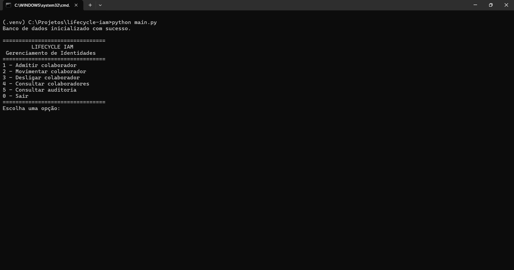
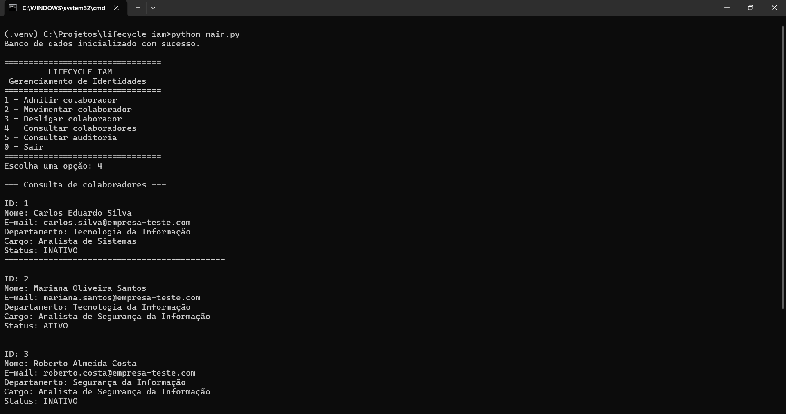

# LifeCycle IAM — Automação do Ciclo de Vida de Identidades Corporativas com Python

Projeto desenvolvido em Python com foco em **Identity and Access Management (IAM)** e automação do gerenciamento de identidades digitais em ambientes corporativos.

O LifeCycle IAM simula processos relacionados ao ciclo de vida de colaboradores, contemplando admissão, movimentação e desligamento, com registro persistente das operações em banco de dados SQLite.

---

## Funcionalidades Implementadas

### 1. Admissão (Joiner)

- Cadastro de novos colaboradores.
- Validação dos dados obrigatórios e do e-mail corporativo.
- Verificação de e-mails duplicados.
- Registro do evento de admissão na auditoria.

### 2. Movimentação (Mover)

- Atualização do departamento do colaborador.
- Atualização do cargo.
- Registro das informações anteriores e atualizadas.
- Histórico da movimentação para fins de auditoria.

### 3. Desligamento (Leaver)

- Confirmação do desligamento.
- Alteração do status do colaborador para INATIVO.
- Impedimento de novo desligamento de um colaborador já inativo.
- Registro do evento na auditoria.

### 4. Consultas e Auditoria

- Consulta dos colaboradores cadastrados.
- Identificação dos colaboradores ativos e inativos.
- Consulta do histórico de operações.
- Armazenamento dos registros em banco de dados SQLite.

---

## Tecnologias Utilizadas

- Python 3
- SQLite
- SQL
- Git
- GitHub

---

## Estrutura do Projeto

```text
lifecycle-iam/
├── data/
├── database/
│   └── lifecycle.db
├── docs/
│   └── evidencias/
├── logs/
├── modules/
│   ├── __init__.py
│   ├── admission.py
│   ├── movement.py
│   └── termination.py
├── reports/
├── main.py
├── README.md
├── LICENSE
└── .gitignore
```

---

## Evidências de Funcionamento

### Menu Principal



### Consulta de Colaboradores



### Histórico de Auditoria — Parte 1


### Histórico de Auditoria — Parte 2


---

## Ambiente de Desenvolvimento

O projeto utiliza um ambiente local de simulação, com dados fictícios. Não realiza criação, alteração ou desativação de contas corporativas reais.

Possíveis integrações com serviços de diretório e plataformas de identidade poderão ser consideradas em etapas futuras, exclusivamente em ambientes de teste autorizados.

---

## Objetivo

Aplicar conceitos de IAM, gerenciamento de identidades, automação de processos e rastreabilidade em Segurança da Informação, demonstrando na prática o ciclo de vida de identidades digitais em uma organização.

---

## Repositório no GitHub

[LifeCycle IAM — Acessar projeto](https://github.com/marcioaugustomazzochi/lifecycle-iam)

**Projeto em desenvolvimento contínuo.**
